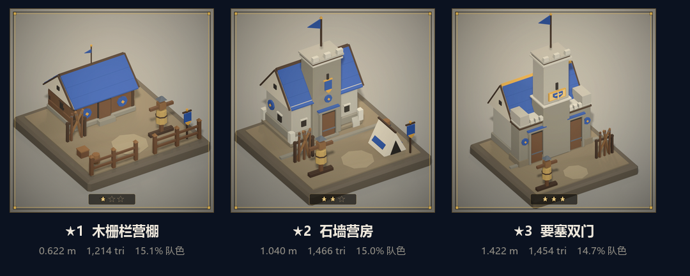

# 兵营 · 微缩线（1 m 格）· v1

《战争原岛》联盟建筑重构的第二座。和 `assets/建筑/联盟/兵营/` 里那批 6 m 级资产
**没有任何关系**（那批走 `bs_v6`，零件不通用）。

这一座同时是**两槽制**的第一个正式资产：全局规范要求"一栋建筑只准两个材质槽"，
和微缩线原来那套四槽制（主体 / team / team_trim / 自发光）正面冲突。取舍写在第 2 节。

---

## 1. 交付物

目录：`assets/建筑/联盟/兵营_微缩/`

| 文件 | 说明 |
|---|---|
| `兵营_1星.glb` | 木栅栏营棚　0.622 m　1,214 tri |
| `兵营_2星.glb` | 石墙营房 + 穿顶望楼　1.040 m　1,466 tri |
| `兵营_3星.glb` | 要塞双门 + 中央望楼　1.422 m　1,454 tri |
| `兵营_{1,2,3}星_图标.png` | 512 图标（暖光背板 + 双线金框 + 星级缎带） |
| `兵营_{1,2,3}星_图标_128.png` | 128 游戏内尺寸 |
| `兵营_图标.png` | 3★ 图标（主图标，旧命名兼容） |
| `兵营_{1,2,3}星_卡牌.png` | 1024 × 1400 卡面（舞台光池 + 铭牌 + 星级） |
| `阵营色.json` | 四套阵营色（两槽制只换一个 baseColor） |

体检（`blender/bs_v7/bk_check.py`，十项）：

```
★1  tris=1214  bbox 1.000 x 1.000 x 0.622  z0=0.000  队色 15.1%  细分 0.0%   PASS
★2  tris=1466  bbox 1.000 x 1.000 x 1.040  z0=0.000  队色 15.0%  细分 0.0%   PASS
★3  tris=1454  bbox 1.000 x 1.000 x 1.422  z0=0.000  队色 14.7%  细分 0.0%   PASS
```

材质槽恰好两个：`Mat_Neutral` / `Mat_TeamColor`。GLB 两个 primitive 都带 `COLOR_0`，
`Mat_TeamColor.baseColorFactor` = 联盟蓝 `#2554A8` 的线性值 `[0.0185, 0.0887, 0.3916]`。
面数留了余量（三档都在 1500 硬线内，最紧的 2★ 还剩 34 tri）。

---

## 2. 两槽制：冲突在哪，怎么落地

全局规范（本座起生效）：

> 每栋建筑严格只建两个材质槽 —— `Mat_Neutral`（石墙 / 木梁 / 灰泥 / 铁器 / 麦田等固定本色）
> 和 `Mat_TeamColor`（所有屋顶瓦片、旗帜、盾徽、门框饰条）。

跟微缩线原来的四槽制有两个硬冲突，都用"改结构"而不是"改口径"解决：

| 冲突 | 原方案 | 两槽制的做法 |
|---|---|---|
| 金/铁需要独立材质提亮 | `team_trim` 槽（漆金 + 铁） | **金和铁烘进顶点色**（`#D9A441` / `#5A6470`），靠明度而不靠金属度；`Mat_Neutral` 只有一个 roughness 0.78 |
| 3★ 需要"微发光水晶" | `自发光` 槽 | **不做灯**：3★ 的"微光"由金色屋脊 + 金剑盾牌匾 + 金桅顶承担 |

队色怎么保证不翻车：`Mat_TeamColor` **不接** Color Attribute，顶点色对队色件一律写
**纯白 1.0**（`bk_check` 第 ⑩ 项逐个顶点验）。这样：

- Blender 里看到的蓝 = GLB 里乘完 `COLOR_0` 的蓝，预览与引擎一致；
- 换阵营只改 `Mat_TeamColor.baseColorFactor`，几何与顶点色都不动；
- 不会出现"蓝 × 灰遮罩"的复合色。

代价说清楚：队色件**没有**明暗微差。屋面层次只能靠瓦垄的 1.3 mm 台阶与光照，
不能靠"瓦暗 / 瓦亮"两种蓝。这是两槽制换来的确定性。

`mkit.py` 里两条路并存：`B(twoslot=False)` 走四槽（城镇大厅），
`B(twoslot=True)` 走两槽（兵营）。互不影响，`th_*` 一个字节没动。

---

## 3. 三档怎么设计的

兵营的身份不是"房子"，是**一块能练兵的院子**。所以三档共用四件识别物：

**蓝瓦屋顶 · 门口交叉长矛 · 墙面圆盾 · 训练木人**

四件里最贵的是屋顶（队色 15% 全在它身上），最便宜的是长矛（36 tri）——
但 96 px 上最先认出来的是长矛和木人，不是屋顶。**钱要花在能读出来的地方。**

| 星 | 语法 | 该有什么 | 高度 |
|---|---|---|---|
| 1★ | **营地** | 原木营房 + 前庭木栅 + 木人 + 交叉长矛 + 立旗 | 0.622 |
| 2★ | **驻地** | 石砌墙 + 台基隅石扶壁 + 穿顶望楼 + 蓝白帐篷 + 挂旗 | 1.040 |
| 3★ | **要塞** | 双门门墙 + 垛口端墩 + 中央望楼（旗桅）+ 金剑盾牌匾 | 1.422 |

递进靠**换语法**，不是加零件：1★ 是"一栋棚 + 一圈栅栏"，2★ 是"一栋石房 + 一座望楼"，
3★ 是"一道门墙 + 一座望楼 + 一栋退到门后的营房"。三档同框缩到 96 px 能排出顺序。

### 3.1 望楼为什么不能是尖顶

第一版 2★/3★ 的望楼顶是**蓝方锥**，出来是一组"教堂 + 钟楼"：细高塔身 + 尖顶 +
中轴对齐的山墙，怎么调都像礼拜堂。改法不是换颜色，是换三件东西：

1. **平顶垛口**：塔顶做成石制平台 + 三到四个垛口，塔就只是"望楼"；
2. **木挑台**：垛口下面压一道深木色挑台（暗带），塔身有了"上大下小"的收头；
3. **旗桅代替尖顶**：总高靠一根三角军旗撑进星级区间，比再盖一层便宜 200 tri。

> 这一条写进规范：**中轴对称的细高塔 + 尖顶 = 教堂语法**。要塞要的是"矮、宽、有垛口"。

### 3.2 前庭是空出来的，不是填满的

三档都在正面留一块 0.30–0.36 m 深的土场 + 一圈浅沙操练圈，道具全部贴边：
木人在右前角、枪架在左前角、桶/箱靠墙。**中间必须空**，那是"操练空地"，
也是 3/4 俯视下唯一能让眼睛落到底座上的地方。

---

## 4. 组件库（`blender/bs_v7/bk_model.py`）

三档共用一套函数，改参数即改款：

```
log_hall        原木营房（石脚 + 交错叠木 + 四角立柱）
stone_hall      石砌体量（台基 / 墙裙 / 墙 / 隅石 / 檐口，可关项）
roof            蓝瓦双坡（瓦垄 + 山墙 + 博风 + 脊压顶，gold=True 换金脊）
door            门（暗洞 / 门扇 / 门框 / 铁箍，detail 0–1）
shield          圆盾（队色盾面 + 金盾钉，挂墙自动探出 6 mm）
rack            武器架（两柱一横 + 立矛 + 交叉长矛）
dummy           训练木人（十字底 / 立杆 / 横臂 / 草靶 / 木盔 / 胸口小盾）
tent            蓝白帐篷（白帆布 + 队色纵条 + 门洞 + 脊杆）
banner          立旗（杆 / 横担 / 旗面 / 金底边）
wall_banner     墙面挂旗（金挑杆 + 垂旗）
watch_top       望楼顶（木挑台 + 石垛口，**必须传 at**）
mast            旗桅（粗杆 + 长三角军旗 + 金顶珠）
turret          角塔（方身 / 檐口 / 蓝方锥 / 箭孔）—— 3★ 因预算未用
plaque          金剑盾牌匾（金背板 + 队色盾 + 竖剑穿盾）
crenel / curb / fence / sand / steps / barrel / crate
```

组件化在代码里的体现就是 `_s1/_s2/_s3` 只做**编排**，不写几何：
换一档只改尺寸和调用顺序，零件本身不动。`_budget()` 记录每个组件的 tri 增量，
`bk_check` 会打印"最重零件"，加件之前先看账。

---

## 5. 生产链

```
blender/bs_v7/mkit.py       零件库（新增 SLOTS2 / ROLE2 / materials2 / twoslot 通道）
blender/bs_v7/bk_model.py   三档造型 + 兵营专用零件
blender/bs_v7/bk_check.py   十项体检（两槽制 / 800–1500 tri / 队色顶点纯净）
blender/bs_v7/bk_export.py  GLB 导出 + 队色回写 + 直接解 GLB 校验
blender/bs_v7/bk_shots.py   图标底片 / 卡牌底片
blender/bs_v7/bk_post.py    图标 512/128 + 卡牌 1024×1400
预览_微缩建筑.html            本地预览（两座建筑切换，四阵营换色）
```

四步出全套（在 `blender/bs_v7/`）：

```
"D:/360安全浏览器下载/blender.exe" -b --factory-startup -P bk_check.py
"D:/360安全浏览器下载/blender.exe" -b --factory-startup -P bk_export.py
"D:/360安全浏览器下载/blender.exe" -b --factory-startup -P bk_shots.py
python bk_post.py
```

造型迭代用 `bk_look.py`（560 px / 24 采样，三档 × 三机位，比交付出图快一倍）：

```
"D:/360安全浏览器下载/blender.exe" -b --factory-startup -P bk_look.py -- 2 3
```

预览走 HTTP（`python -m http.server 8905`），`file://` 会被 CORS 拦 GLB。

---

## 6. 这一轮踩的坑

1. **中轴对称的尖塔 = 教堂**。兵营的竖向度只能来自"望楼 + 旗桅"，不能来自 spire。
   这一条推翻了两版造型，是本轮最贵的一课。
2. **`watch_top()` 忘了传 `at`**：整圈垛口落在原点，塔顶变成一块伸出去的白色托盘。
   和 `merlons()` 那次是同一个错 —— **带坐标参数的组合件，必须给 `at`**。
3. **木盒子做平台顶 = 泥屋顶**。`挑台` 是深木色实体盒，它的顶面就是"屋顶"；
   改成"暗木只做檐下暗带 + 亮石做顶面"之后，同一个体量立刻读成石制垛口平台。
4. **亮石门框让门读成窗**。门框改暗石（`石暗`）之后才有"洞"的进深。
5. **细杆上挂方旗 = 棒棒糖**。换成长三角军旗（12 tri）立刻读成"军旗"。
6. **牌匾三件必须同心**：上一版把盾缩成小圆挤在左边，读出来是一只相框；
   改成"盾在下、剑居中穿盾、护手横过盾心"（48 tri）才成徽。
7. **门墙檐不能宽过墙**：`+0.022` 的亮色檐口会变成一条"搁板"，上面的垛口读成
   摆在架子上的方块。收到 `+0.008`。
8. **1500 硬线下的取舍**：3★ 原设计有两座角塔（+228 tri），砍掉换成垛口端墩
   （+24 tri），剪影照样"咬住转角"。**钱不够时先砍重复的竖向件，别砍识别件。**

---

## 7. 已知欠账

- **城镇大厅 3★ 是 2,388 tri**，超了全局规范给它的 2,000 tri 放宽线。
  它是上一版的四槽制资产，本轮没动；要合规范得单独返工（计划随城镇大厅 v3 一起做）。
- 两槽制没有发光槽，3★ 的"微发光水晶"用金脊 + 盾徽替代。若后续一定要发光，
  得开第三个槽，那要全局规范先松口。
- `turret()` 已写好但 3★ 没用（预算）。若以后放宽到 1,800 tri，两座角塔是第一个要加回去的件。


