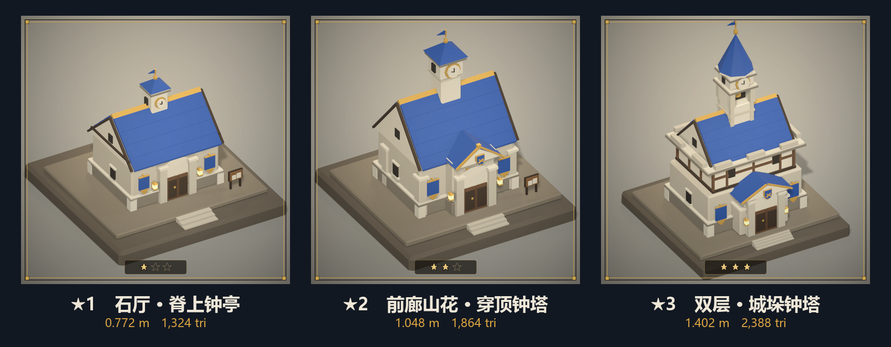

# 城镇大厅 · 微缩线（1 m 格）· v2

《战争原岛》联盟建筑重构的第一座。**新线，和 `assets/建筑/联盟/城镇大厅/`
里那批 6 m 级资产没有任何关系**（那批是老项目的，别混用）。

v2 起因是三个具体问题：一星屋顶是棕色、没有换色办法、一星不像城镇大厅像民房。

---

## 1. 交付物

目录：`assets/建筑/联盟/城镇大厅_微缩/`

| 文件 | 说明 |
|---|---|
| `城镇大厅_1星.glb` | 石厅 + 脊上钟亭　0.772 m　1,324 tri |
| `城镇大厅_2星.glb` | 前廊山花 + 穿顶钟塔　1.048 m　1,864 tri |
| `城镇大厅_3星.glb` | 双层 + 城垛露台 + 钟塔　1.402 m　2,388 tri |
| `城镇大厅_{1,2,3}星_图标.png` | 512 图标（暖光背板 + 双线金框 + 星级缎带） |
| `城镇大厅_{1,2,3}星_图标_128.png` | 128 游戏内尺寸 |
| `城镇大厅_图标.png` | 3★ 图标（主图标，旧命名兼容） |
| `城镇大厅_{1,2,3}星_卡牌.png` | 1024 × 1400 卡面（舞台光池 + 铭牌 + 星级） |
| `阵营色.json` | 四套阵营色 + 换色说明 |

体检（`blender/bs_v7/th_check.py`，九项）：

```
★1  tris=1324  bbox 1.000 x 1.000 x 0.772  z0=0.000  队色 18.0%  细分 0.0%   PASS
★2  tris=1864  bbox 1.000 x 1.000 x 1.048  z0=0.000  队色 20.0%  细分 0.0%   PASS
★3  tris=2388  bbox 1.000 x 1.000 x 1.402  z0=0.000  队色 14.1%  细分 9.0%   PASS
```

材质槽：`主体` / `team` / `team_trim` / `自发光`。
GLB 四个 primitive 全部带 `COLOR_0`；`team` / `team_trim` 的 `baseColorFactor`
已按联盟色写死（`#2554A8` / `#E4B455`）。

---

## 2. 队色 = 染色系统

v1 的蓝是**烘死在顶点色里**的，换阵营得重跑建模。v2 把色相从几何里剥出来：

- `team` / `team_trim` 的顶点色只存 **0.86–1.0 的灰阶遮罩**，色相来自材质 baseColor；
- 队色槽**不接** Color Attribute —— 接了就是"顶点色 × 材质色"，
  换阵营时两个颜色相乘，蓝 × 红 = 泥；
- 导出后回写 GLB 的 `baseColorFactor`；整套阵营色另存 `阵营色.json`。

| 阵营 | team | team_trim |
|---|---|---|
| 联盟（默认） | `#2554A8` | `#E4B455` |
| 失落帝国 | `#743A2E` | `#A99578` |
| 中立 | `#4C6B58` | `#B9A87A` |
| 霜誓 | `#2F6F86` | `#CBD6D8` |

**怎么用**：运行时改 `material['team'].color`，几何与顶点色都不动。
`预览_微缩建筑.html` 底部那排色块就是这套系统的现场演示（三档同时变色）。

**金为什么不是真金属**：metallic 0.82 在弱环境下把 `#D9A441` 读成脏棕，
微缩件一律走"漆金"——metallic 0.32 / roughness 0.46 / `#E4B455`。

---

## 3. 三档怎么设计的

市政身份只有四件东西撑得住：**钟面、拱门、蓝瓦、挂旗**。1★ 可以小，这四件一件不能少。

### 1★ 石厅 · 脊上钟亭　0.772 m　1,324 tri

单一体量。蓝瓦双坡顶（4 道叠瓦）+ 金脊压顶 + 脊上钟亭（钟面 + 蓝方锥 + 三角旗）
+ 拱门（石门柱 / 拱券 / 双扇木门 / 金门环）+ 一对挂旗 + 一对壁灯 + 公告板。
山墙做灰泥 + 横枋 + 小窗，四角隅石。台基前 3 级台阶落到地面。

v1 的烟囱与披屋全删了 —— 那两件是农舍语法，一件都不能留。

### 2★ 前廊山花 · 穿顶钟塔　1.048 m　1,864 tri

语法变化：正面多一个**前凸体量**，山花里嵌盾徽；塔从"脊上的亭"变成"穿过屋顶的塔"，
钟室出挑；墙拿到扶壁 + 隅石；屋面 5 道瓦。台阶移到台基之前，前角放公告板。

### 3★ 双层 · 城垛钟塔　1.402 m　2,388 tri

两层退台 + 露台城垛 + 门廊（实心墩柱 + 竖脊山花 + 盾徽）。钟塔分三段：
塔身（四角壁柱）→ 钟室（四角柱 + 看得见钟）→ 钟面层 → 八角金尖顶 → 三角旗。
两对挂旗 + 两盏壁灯。

---

## 4. 生产链

```
blender/bs_v7/mkit.py        零件库（队色遮罩 / 细分通道 / 瓦垄 / 钟面 / 钟）
blender/bs_v7/th_model.py    三档造型
blender/bs_v7/th_check.py    九项体检
blender/bs_v7/th_export.py   GLB 导出 + 阵营色回写 + GLB 校验
blender/bs_v7/th_shots.py    图标底片 / 卡牌底片
blender/bs_v7/th_post.py     图标 512/128 + 卡牌 1024×1400
预览_微缩建筑.html            本地预览（three.js r169，四阵营换色）
docs/10-规范/微缩建筑规范.md   规范（v2）
```

四步出全套：

```
cd blender/bs_v7
"D:/360安全浏览器下载/blender.exe" -b --factory-startup -P th_check.py
"D:/360安全浏览器下载/blender.exe" -b --factory-startup -P th_export.py
"D:/360安全浏览器下载/blender.exe" -b --factory-startup -P th_shots.py
python th_post.py
```

预览走 HTTP（`python -m http.server 8905`），`file://` 会被 CORS 拦 GLB。

---

## 5. 本轮新踩的坑

1. **台阶全被台基埋掉**：`steps()` 以中点居中，最前一级多探出 `tread*(n-1)/2`，
   直接顶出 1 m 底座；而且台基比台阶深，整段楼梯在实体内部，只剩一条白线。
   → 每级从台基边往前长，台基比台阶浅。
2. **指针埋进钟面**：读完是一个黑洞。指针必须画在盘面之前 6 mm，盘面用米白。
3. **挂旗中间折一道**读成纸飞机。1 m 尺度上布不需要褶。
4. **方条屋脊在 45° 屋面上必然翘起**：底边水平、屋面往下走。
   脊压顶必须做成**与屋面同坡**的小三棱柱，瓦垄在脊前 5.5% 收住。
5. **metallic 0.82 的金 = 脏棕**。
6. **细分面数要算真账**：`B.info` 是控制笼的 tri，体检得用 `B.actual`，
   否则 SOFT_RATIO 少算四倍。

---

## 6. 版本

- v1（2026-11-18）：三档 868 / 888 / 1,492 tri，木瓦顶 + 烟囱 + 披屋。
  已归档到 `_历史版本/城镇大厅_微缩_v1/`。
- v2（2026-11-23）：本版。旧版代码 `_历史版本/mkit_v1.py`、`_历史版本/th_model_v1.py`。


